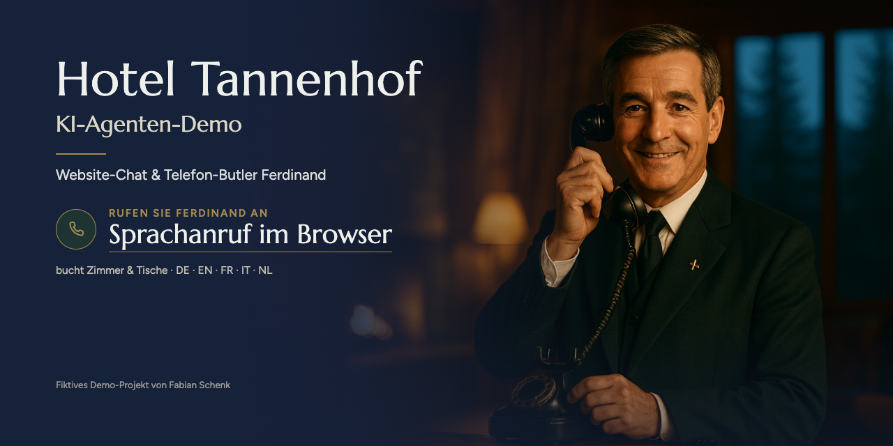
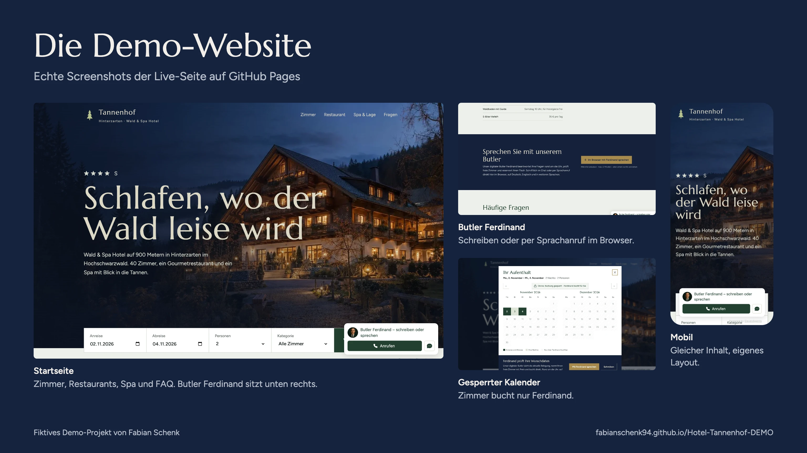
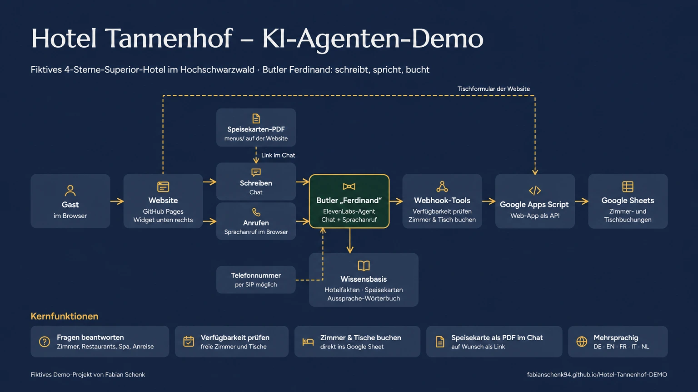
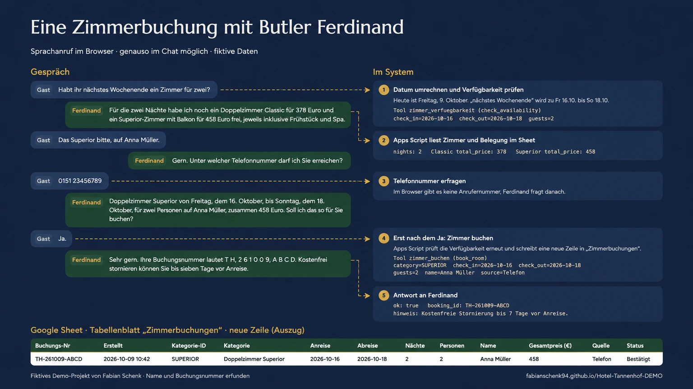
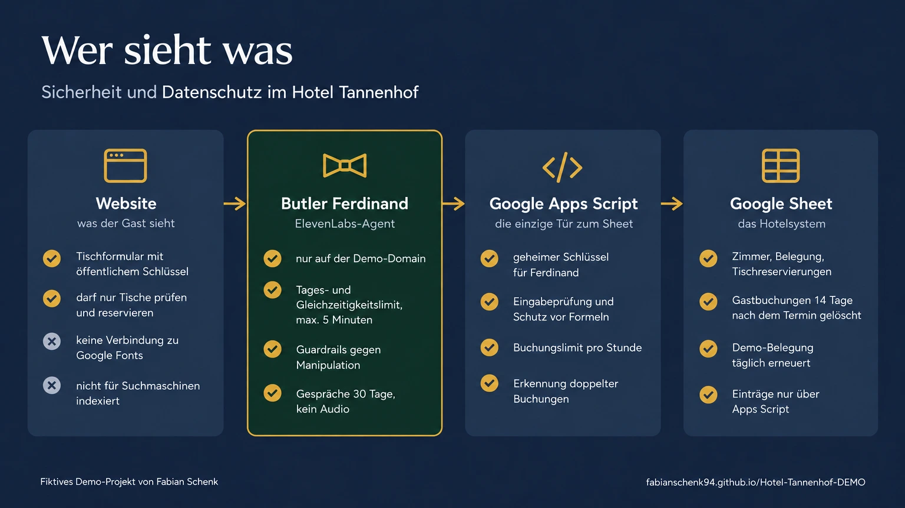

# Hotel Tannenhof Hinterzarten – KI-Agenten-Demo

**Live-Website:** https://fabianschenk94.github.io/Hotel-Tannenhof-DEMO/

> Fiktives Demo-Hotel. Kein reales Haus, keine echten Buchungen.

**Ausprobieren:** Auf der Website unten rechts Ferdinand öffnen und **schreiben** oder **anrufen** (Mikrofon erlauben, Demo, max. 5 Minuten). Den Sprachanruf startet auch der Button „Im Browser mit Ferdinand sprechen“.

Ein vollständig erfundenes 4-Sterne-Superior-Hotel im Hochschwarzwald mit einem KI-Butler, der schreibt, spricht und bucht:

| Agent | Kanäle | Aufgabe |
|---|---|---|
| **Butler „Ferdinand“** | Chat und Sprachanruf im selben Website-Widget (Telefonanbindung per SIP vorbereitet) | Beantwortet Fragen zu Zimmern, Restaurants, Spa und Anreise, stellt die Speisekarten auf Wunsch als PDF-Link in den Chat, prüft freie Zimmer und Tische und bucht – live im Google Sheet. |

Ferdinand antwortet standardmäßig auf Deutsch und wechselt bei Bedarf auf Englisch, Französisch, Italienisch oder Niederländisch.

## Was das Projekt zeigt

| Fähigkeit | Wo nachzulesen |
|---|---|
| **Prompt Engineering** für einen Agenten mit zwei Kanälen: getrennte Regeln für Chat und Sprachanruf, Demo-Hinweis, Vertraulichkeit, Datensparsamkeit | [`docs/agent-telefon-butler.md`](docs/agent-telefon-butler.md) |
| **Tool-Einsatz**: vier Webhook-Tools (Zimmer und Tische prüfen und buchen), Buchung erst nach klarem Ja | [`docs/agent-telefon-butler.md`](docs/agent-telefon-butler.md), [`docs/Code.gs`](docs/Code.gs) |
| **Backend ohne Server**: Google Apps Script als API, Google Sheet als Hotelsystem, Eingabeprüfung, Limits, Erkennung doppelter Buchungen | [`docs/Code.gs`](docs/Code.gs) |
| **Sprach-UX**: vorlesbare Sätze, relative Daten wie „nächstes Wochenende“, Aussprache-Wörterbücher für Orte, Zimmer und Gerichte | [`docs/Tannenhof-Aussprache-IPA.pls`](docs/Tannenhof-Aussprache-IPA.pls), [`docs/Belvedere-Speisekarte-Butler.md`](docs/Belvedere-Speisekarte-Butler.md) |
| **Wissensaufbereitung**: Hotelfakten und Speisekarten so geschrieben, dass ein Agent sie sicher wiedergibt | [`docs/wissensbasis.md`](docs/wissensbasis.md), [`docs/speisekarten.md`](docs/speisekarten.md) |
| **Mehrsprachigkeit**: Deutsch, Englisch, Französisch, Italienisch, Niederländisch | [`docs/agent-telefon-butler.md`](docs/agent-telefon-butler.md) |
| **Sicherheit und Datenschutz**: getrennte Schlüssel, Domain-Bindung, Löschfristen | siehe unten |

## Architektur

- **Butler Ferdinand:** ein ElevenLabs-Agent für Text und Sprache mit vier Webhook-Tools (Zimmer prüfen, Zimmer buchen, Tisch prüfen, Tisch reservieren). Der System-Prompt regelt beide Kanäle getrennt: im Sprachanruf kurze, vorlesbare Sätze ohne Adressen und Sonderzeichen, im Chat Euro-Zeichen, kurze Listen und Markdown-Links zu den Speisekarten. Wissensbasis: Hotelfakten plus sprechgerecht aufbereitete Speisekarten; dazu Aussprache-Wörterbücher für Ortsnamen, Zimmer und Gerichte.
- **Backend:** Google Apps Script als Web-App, Google Sheet als „Hotelsystem“ mit Zimmern, Belegung und Tischreservierungen. Zwei Schlüssel: ein geheimer für Ferdinand, ein öffentlicher für das Tischformular, der nur Tische prüfen und reservieren darf. Dazu Eingabeprüfung, Schutz vor Formeln im Sheet, Buchungslimit pro Stunde, Erkennung doppelter Buchungen und eine täglich erneuerte Demo-Belegung.
- **Website:** statischer One-Pager (HTML, CSS, JavaScript) auf GitHub Pages. Das Tischformular schreibt direkt über Apps Script ins Sheet. Die Zimmer-Verfügbarkeit öffnet bewusst einen gesperrten Kalender und leitet zu Ferdinand weiter.
- **Bilder:** Fotos und Grafiken KI-generiert (OpenAI Images), die Website-Screenshots sind echt.

## So läuft eine Buchung mit Ferdinand

1. Der Gast startet den Sprachanruf und nennt Anreise, Abreise und Personenzahl.
2. Ferdinand rechnet relative Angaben wie „nächstes Wochenende“ in Daten um und ruft `zimmer_verfuegbarkeit` auf.
3. Er nennt höchstens drei passende freie Kategorien mit Gesamtpreis.
4. Nach Namen und Telefonnummer fasst er alles zusammen und wartet auf ein klares Ja.
5. Erst dann ruft er `zimmer_buchen` auf. Die Buchung steht sofort als neue Zeile im Google Sheet, der Gast erhält eine Buchungsnummer (z. B. `TH-261009-AB12`).

Tischreservierungen laufen genauso, inklusive Ruhetagen und belegter Uhrzeiten.

## Inhalt

| Datei | Zweck |
|---|---|
| `index.html`, `img/`, `fonts/` | Website, Bilder (WebP) und lokal eingebundene Schriften |
| `menus/` | Speisekarten Belvedere und Kaminstube als PDF (auf der Website verlinkt) |
| `docs/wissensbasis.md` | Wissensbasis von Ferdinand |
| `docs/speisekarten.md` | Speisekarten als Wissensdokument (Listenform) |
| `docs/Belvedere-Speisekarte-Butler.md`, `docs/Kaminstube-Speisekarte-Butler.md` | Speisekarten fürs Telefon: Kurzfassungen zum Vorlesen, Details auf Nachfrage |
| `docs/Tannenhof-Zimmer.pls`, `docs/Tannenhof-Aussprache-*.pls` | Aussprache-Wörterbücher (Hinterzarten, Suite, Schäufele …) |
| `docs/agent-telefon-butler.md` | System-Prompt (Chat und Sprache), Tool-Definitionen und Testfälle von Ferdinand |
| `docs/agent-website-chat.md` | Archiv: frühere Variante mit separatem FAQ-Chat (nicht mehr eingebunden) |
| `docs/Code.gs` | Apps-Script-Backend: Verfügbarkeit, Zimmerbuchung, Tischreservierung |
| `docs/ANLEITUNG.md` | Einrichtung Schritt für Schritt |
| `docs/bilder-prompts.json` | Prompts für die Bildgenerierung |

## Sicherheit und Datenschutz

- **Ferdinand:** nur auf der Demo-Domain einsetzbar, Tages- und Gleichzeitigkeitslimit, maximal 5 Minuten pro Gespräch. Guardrails gegen Themenabweichung, Manipulation und unangemessene Inhalte; der System-Prompt regelt Demo-Hinweis, Vertraulichkeit und Datensparsamkeit.
- **Daten:** Gesprächsverläufe werden 30 Tage gespeichert, Audio gar nicht. Gast-Buchungen werden 14 Tage nach dem Termin automatisch gelöscht.
- **Website:** keine Verbindung zu Google Fonts, Widget-Version fest eingebunden, nicht für Suchmaschinen indexiert.

## Konzept und Umsetzung

Fabian Schenk – [LinkedIn](https://www.linkedin.com/in/fabianschenk-ai)

**Weiteres Projekt:** [StaffGrid Support – AI agent demo](https://github.com/FabianSchenk94/StaffGrid-Support-DEMO), ein fiktives Support-Portal für eine Workforce-Management-Cloud. Der KI-Agent Adrian beantwortet Fragen, vergibt eine erste Priorität und eröffnet Fälle in Jira, per Chat oder Sprache, auf Englisch, Französisch und Deutsch.
